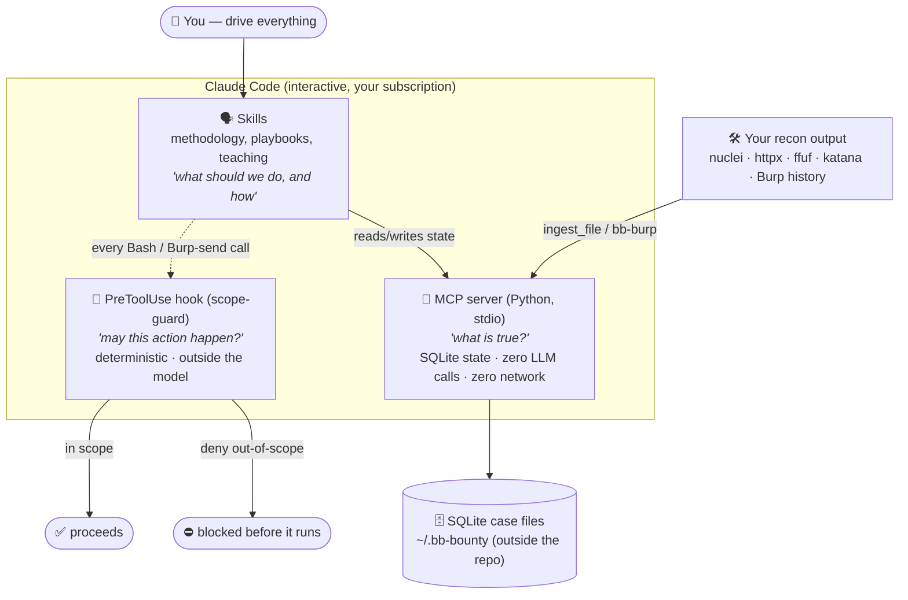
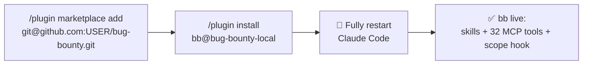
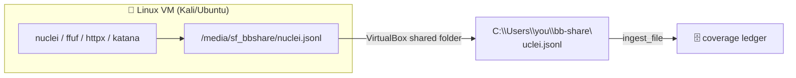
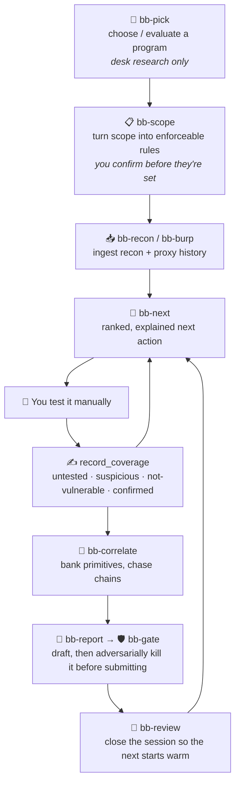
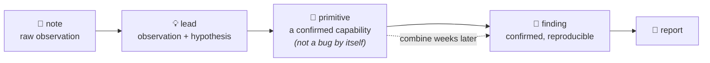

# 🐞 bb — a human-in-the-loop bug bounty research assistant

> A Claude Code plugin that helps you hunt **systematically** on programs you're
> authorized to test. It remembers what you've covered, enforces scope
> mechanically, teaches you what to notice, and drafts grounded reports — while
> **you** stay in control of every action that touches a live target.

**bb is ingest-only: it never sends traffic to any target.** You run the tools and
browse; bb reads what you produce, organises it, and tells you the highest-value
next move. It runs entirely inside Claude Code on your Pro/Max subscription — no
API key, no background agents.

---

## Table of contents

- [Why this exists](#why-this-exists)
- [What makes it different](#what-makes-it-different)
- [Architecture](#architecture)
- [Prerequisites](#prerequisites)
- [Installation](#installation)
- [Verify it works](#verify-it-works)
- [Optional: Burp Suite + VirtualBox](#optional-burp-suite--virtualbox)
- [The daily workflow](#the-daily-workflow)
- [Core concepts (recap)](#core-concepts-recap)
- [A worked example](#a-worked-example)
- [Skills reference](#skills-reference)
- [Safety model](#safety-model)
- [Autonomous sandbox mode (v0.2.0)](#autonomous-sandbox-mode-v020)
- [Data & privacy](#data--privacy)
- [Troubleshooting](#troubleshooting)
- [Project layout](#project-layout)

---

## Why this exists

If you know the theory of the OWASP Top 10 but freeze on a real app — *"I don't
have a repeatable process, so I stare at the target and don't know where to
start"* — that's the exact problem bb solves.

The gap for most new hunters isn't knowledge, it's **process and memory**:

- You test a few things Tuesday, come back Sunday, and can't remember what you covered.
- You find a half-bug, can't escalate it, and throw it away — instead of banking it for a chain three weeks later.
- You spend a session poking randomly instead of working a surface to exhaustion.

bb turns hunting into a **repeatable loop** backed by durable state, so every
session starts warm and you always have a ranked, explained next move.

---

## What makes it different

Most AI bug-bounty tooling is a *prompt library* — more text about how IDOR works.
bb is built around the things prompts can't give you:

| Principle | How bb does it |
|---|---|
| 🧠 **Durable memory** | A SQLite *coverage ledger* per target: every endpoint × test-case × result, across sessions. |
| 🚧 **Mechanical scope enforcement** | A `PreToolUse` hook — real code outside the model — that **hard-blocks** out-of-scope commands. Can't be prompt-injected or forgotten. |
| 🙌 **Human-in-the-loop** | bb proposes; you execute. It never sends traffic, never marks a finding "real" — that's your call. |
| 💳 **Runs on your subscription** | Interactive Claude Code only. No API key, no metered billing, no background hunters. |
| 🎯 **Grounded, not fabricated** | Reports are assembled from *stored evidence only*; missing pieces become `[YOU MUST FILL THIS IN]`, never plausible filler. |

**By the numbers:** 32 MCP tools · 36 skills (13 workflow + 23 vulnerability-class
playbooks) · a 98-entry test-case taxonomy (73 OWASP WSTG + 25 bounty-specific) ·
24 "first-signal" teaching classes · 223 passing tests.

---

## Architecture

Three layers, each doing only what it's good at. The layer that must not be
fooled (scope enforcement) is the one that **isn't** made of prompts.



| Layer | Question it answers | Made of | Fooled by a prompt? |
|---|---|---|---|
| **Hook** | *May this happen?* | Python script | ❌ No — runs outside the model |
| **MCP server** | *What is true?* | Python + SQLite | ❌ No — no LLM inside it |
| **Skills** | *What should we do, and how?* | Markdown | ✅ Yes — so it's never the enforcement layer |

---

## Prerequisites

| Requirement | Notes |
|---|---|
| **Claude Code** | Signed in with a **Pro or Max** subscription (no API key needed). |
| **Python 3.13** | The MCP server is Python; only one dependency (`mcp`). |
| `pip install mcp` | The single runtime dependency. Everything else is the standard library. |
| **Git + a GitHub repo** | bb installs as a plugin from a git marketplace (this repo). |

> ⚠️ Make sure `ANTHROPIC_API_KEY` is **not** set in your environment — it silently
> overrides your subscription and switches Claude Code to metered API billing.

---

## Installation

bb ships as a Claude Code **plugin** distributed from this repo acting as a
*marketplace*. Two commands, then a restart.



**1. Add this repo as a marketplace** (in the Claude Code prompt):

```
/plugin marketplace add git@github.com:cincaoais/bug-bounty.git
```
> You can also use the HTTPS URL, the `owner/repo` shorthand, or a local path.
> A private repo works fine over SSH.

**2. Install the plugin:**

```
/plugin install bb@bug-bounty-local
```
`bug-bounty-local` is the **marketplace** name; `bb` is the **plugin** name.

**3. Fully restart Claude Code.** This matters: skills and hooks hot-reload, but
**MCP servers spawn at startup** — a restart is what actually launches the bb
server. `/reload-plugins` is not enough on its own.

**Updating later** (after any change is pushed to `main`):

```
/plugin marketplace update bug-bounty-local
/plugin install bb@bug-bounty-local     # reinstall over the top
# then fully restart Claude Code
```

<details>
<summary><b>Fallback if the plugin loader won't cooperate</b></summary>

Wire the three pieces directly:

1. **Skills** — copy `plugin/skills/*` into `~/.claude/skills/`.
2. **MCP server** — `claude mcp add bb -- python "<repo>/plugin/mcp/server.py"`
3. **Hook** — add a `PreToolUse` entry to `~/.claude/settings.json` running
   `python "<repo>/plugin/hooks/scope-guard.py"` on the `Bash` matcher.

See [`docs/setup.md`](docs/setup.md) for the exact JSON.
</details>

---

## Verify it works

Ask Claude to run the `health_check` tool. Expected — all green:

```json
{
  "data_dir": "C:\\Users\\you\\.bb-bounty",
  "gitignore": { "safe": true,  "message": "Case data is not inside a git repo with a remote." },
  "env":       { "safe": true,  "message": "No ANTHROPIC_API_KEY override detected." }
}
```

Then prove the **scope hook** actually blocks. Create a throwaway target scoped
to `*.example.com`, then try an out-of-scope command:

```
curl https://blocked.invalid/probe
```
```
⛔ Blocked by bb scope-guard (target 'test'). Out of scope:
  - blocked.invalid/probe — no matching in-scope rule (deny-by-default)
If this is authorized, run mcp__bb__scope_override then retry.
```

If you see that denial, the safety layer is live.

---

## Optional: Burp Suite + VirtualBox

### Burp Suite MCP (proxy history → ledger)

bb can turn your **Burp proxy history** into mapped endpoints — reading only,
never replaying.

1. Burp → **Extensions → BApp Store → "MCP Server"** (by PortSwigger) → Install.
2. Open the new **MCP** tab, start the server (note the port, e.g. `127.0.0.1:9876`).
3. Register it: `claude mcp add burp --transport http http://127.0.0.1:9876/mcp`
   (use the exact URL the extension shows), then restart Claude Code.
4. The `bb-burp` skill uses only Burp's **read** tools. And bb's scope hook now
   also gates Burp's *send* tools (`send_http1_request`, etc.) on the target host —
   so even a proxied send can't leave scope.

> No Burp MCP? Export proxy history to XML in Burp, then `ingest_file(target, path, "burp")`.

### VirtualBox shared folder (VM recon → Windows)

If you run recon tools inside a Linux VM, bridge the output to Windows with a
shared folder:



VM **powered off** → Settings → Shared Folders → add a Windows folder, name it
`bbshare`, tick **Auto-mount** + **Make Permanent**. In the guest it appears at
`/media/sf_bbshare` (add yourself to the `vboxsf` group if permission-denied).

> A VM isn't required — those tools also have native Windows builds. The VM path
> is only if you prefer a Kali/Ubuntu toolchain.

---

## The daily workflow



The one rule that runs through all of it: **bb proposes, you execute.** Every
action that touches a live target is yours.

---

## Core concepts (recap)

### 1. The coverage ledger — the thing that solves problem #1

Every target has a ledger of **(endpoint × test-case × status)**. That's what
makes *"what have I already tested, and what haven't I?"* a query instead of a
guess — and it's why `bb-next` can always rank the highest-value untested move.

Statuses carry meaning:

| Status | Meaning | Effect |
|---|---|---|
| `untested` | not attempted | eligible |
| `suspicious` | something looked off — unfinished lead | **resurfaces at the top** with a bonus |
| `not-vulnerable` | tried, ruled out | dropped |
| `confirmed` | you verified it | tracked for reporting |
| `n-a` | doesn't apply here | removed |

### 2. The findings hierarchy — so you stop throwing away half-bugs



**Primitives are the point.** *"I can control the Host header and it reaches the
backend"* isn't a bug — but banked, it combines three weeks later with an
internal hostname you noticed elsewhere into an SSRF. bb makes recording them
cheap and resurfaces them.

### 3. Mechanical scope enforcement

The `PreToolUse` hook checks **every** Bash command (and Burp-send call) against
the active target's scope, deny-by-default. Out-of-scope → blocked before it
runs. Explicit out-of-scope rules beat wildcard in-scope rules. It's code, not a
prompt — so prompt injection and context loss can't defeat it.

### 4. Grounded reports

`assemble_report` builds a draft **only from stored evidence**. Missing sections
become literal `[YOU MUST FILL THIS IN: ...]` markers — never invented steps,
never fake request/response pairs. Then `bb-gate` plays hostile triager and
tries to *kill* the finding (scope, duplicate, reproducibility, self-inflicted,
impact, severity) before you ever submit.

---

## A worked example

```text
you ▸  I'm working acme. What should I do next?

bb  ▸  Coverage: 27 endpoints mapped, 4 tested. Auth flows and file upload
       are completely untouched — that's where unmapped risk concentrates.

       Top of the list:

       [91] GET  /api/v1/orders/{id}          BB-IDOR-01
            why: numeric sequential ID under an authed route — the single
            highest-yield IDOR shape. Untested.
       [88] POST /api/v1/orders/{id}/cancel   BB-IDOR-01
            why: same ID pattern but state-changing — mutating endpoints get
            checked less carefully than the GET beside them.
       [78] POST /account/2fa/verify          BB-2FA-01
            why: entire auth surface untested; 2FA flows commonly diverge
            from the main login's protections.

you ▸  Tested the first one across two accounts — I can read another user's
       order. Not fully sure of impact yet.

bb  ▸  Recorded as 'suspicious' on /api/v1/orders/{id} (BB-IDOR-01) — it'll
       resurface at the top next session. Want me to store the request/
       response as evidence? (secrets get redacted before anything hits disk)
```

Later, once you've confirmed it and promoted it to a finding, `bb-report` drafts
it from that stored evidence and `bb-gate` checks it's actually submittable.

---

## Skills reference

**Workflow skills (13)** — invoke with `/bb-<name>` or let Claude pick them:

| Skill | Purpose |
|---|---|
| `bb-target` | create / switch / list targets |
| `bb-pick` | choose or evaluate a program (desk research only) |
| `bb-scope` | turn published scope into enforceable rules |
| `bb-recon` | ingest nuclei/httpx/ffuf/katana/burp output + triage |
| `bb-burp` | bridge Burp proxy history into the ledger (read-only) |
| `bb-code` | read client-side JS & source-available code (zero-traffic surface) |
| `bb-next` | **the core loop** — ranked, explained next action |
| `bb-correlate` | notes → leads → primitives, and chain hunting |
| `bb-report` | draft a grounded report or critique your draft |
| `bb-gate` | adversarial pre-submission gate |
| `bb-learn` | disclosed-report study, drills on your live target |
| `bb-review` | end-of-session retrospective + coverage report |
| `bb-hunt` | router → the right vulnerability-class playbook |

**Playbooks (23)** — `pb-*`, each a methodology (not a payload dump), routed by
`bb-hunt`:

`idor-bola` · `broken-access-control` · `ssrf` · `business-logic` ·
`authentication-flaws` · `session-management` · `mass-assignment` ·
`graphql-abuse` · `race-condition` · `xss` · `sql-injection` · `injection`
(SSTI/cmd/XXE) · `csrf` · `open-redirect` · `file-upload` · `path-traversal` ·
`jwt-flaws` · `oauth-flaws` · `cors-misconfig` · `subdomain-takeover` ·
`secrets-exposure` · `request-smuggling` · `cache-poisoning`

Each playbook follows the same 8 sections: *When this applies · First signals ·
Enumeration · Test procedure · Evidence to capture · Escalation · Out-of-scope
traps · Integration.* Written at OWASP WSTG level — what to observe and how to
confirm, **no weaponized payloads**.

---

## Safety model

**bb does:** organise, correlate, teach, and draft — all from data you provide.

**bb does NOT:**
- ❌ send traffic to any target (ingest-only)
- ❌ run scanners or an autonomous hunting loop
- ❌ run as a background daemon or on a schedule
- ❌ mark a finding "real" — only you can, with explicit confirmation
- ❌ call the Anthropic API itself (no key, subscription only)

**Guarantees it enforces mechanically:**
- Scope is checked by a hook outside the model; unknown host → denied.
- Findings can't be created without a human-confirmation flag.
- Ingested target content is treated as **data, never instructions** (prompt-injection posture) — mitigated in depth, though no defense is total.

---

## Autonomous sandbox mode (v0.2.0)

Everything above is ingest-only. `bb-sandbox` is the one deliberate exception: an
**opt-in** skill that autonomously discovers, exploits, and *scores* vulnerabilities —
but only against a **local, deliberately-vulnerable training target** (OWASP Juice
Shop or OWASP WebGoat), never a real program.

```
try to find bugs in OWASP Juice Shop, it's at http://localhost:3000
```

That single prompt runs a narrated recon → hypothesize → exploit → verify → record →
score loop and ends in a **grounded scorecard** — read from the target app's own solve
state (Juice Shop's `/api/Challenges`, WebGoat's `reportcard.mvc`), never from Claude's
self-report. It's built for reps: watching *how* a bug gets found on a real-shaped app,
not another definition dump.

**Opt-in and localhost-only, by construction:**
- It only activates for a target explicitly created with `mode="sandbox"` — every
  existing target, and the entire ingest-only workflow above, is unaffected.
- Traffic is confined to a `(host, port)` allow-list of loopback addresses only
  (`127.0.0.1` / `localhost` / `[::1]` on the target's declared port) — no wildcards,
  no override, deny on any ambiguous command.

**Two-layer safety model — both required, neither is a backstop for the other:**

| Layer | Enforces |
|---|---|
| Scope-guard hook | Deny-by-default allow-list, deny-on-ambiguity, no override — the same hook that gates real programs, running a stricter sandbox branch. |
| Network isolation | The target container runs with no route off-box (Docker `--network internal` + `127.0.0.1`-only bind, or an isolated VirtualBox host-only VM) — the real backstop for what a hook structurally can't see (server-side SSRF, browser click/JS navigation). |

Full setup — Docker and VirtualBox topologies, browser containment, preflight, and
reset — is in [`docs/sandbox-setup.md`](docs/sandbox-setup.md). Read it before your
first run; the skill's own preflight aborts rather than proceeding on unverified
containment.

---

## Data & privacy

- Case data lives in **`~/.bb-bounty`**, deliberately **outside this repo** so it
  can't be committed. `health_check` warns if it ever lands inside a git-remote repo.
- **One SQLite file per target** — deleting a program is one file.
- Evidence is **redacted before it touches disk** — session tokens, cookies,
  API keys, JWTs, and obvious PII are stripped; the useful HTTP structure and
  things like `role=user` survive so reports stay writable.
- Targets carry a `public | private | nda` flag; private/NDA targets are meant to
  be flagged every session and never pasted into external lookups.

---

## Troubleshooting

| Symptom | Fix |
|---|---|
| `/plugin install bb` → "not found in any marketplace" | Add the marketplace **first** (step 1), then install. |
| `bb-*` skills / MCP tools don't appear | The plugin wasn't installed/enabled, or you didn't **restart** — MCP servers spawn at startup. |
| Scope hook never blocks | Not wired — use the fallback in [`docs/setup.md`](docs/setup.md); confirm with the verify step. |
| Routine commands get denied | You're on an old hook version — update + reinstall + restart to get ≥ v0.1.1. |
| `health_check` says data dir unsafe | Move `BB_DATA_DIR` out of the git-remote repo it names. |
| Claude refuses an exploit-dev request | Expected at v1's boundary; rephrase toward analysis, or it's out of scope for v1. |

---

## Project layout

```
bug-bounty/
├─ README.md                     ← you are here
├─ .claude-plugin/
│  └─ marketplace.json           marketplace manifest (points at ./plugin)
├─ plugin/                       the installable plugin
│  ├─ .claude-plugin/plugin.json manifest: hooks wiring, version
│  ├─ .mcp.json                  registers the bb MCP server
│  ├─ mcp/                       Python: server, scope, db, coverage,
│  │                             ingest, correlate, redact, report, safety
│  ├─ hooks/scope-guard.py       the PreToolUse scope enforcer
│  ├─ skills/                    36 skills (bb-* workflow + pb-* playbooks)
│  └─ reference/                 WSTG + bounty taxonomy, first-signal data
├─ tests/                        223 tests (scope, hook, ingest, redaction…)
└─ docs/
   ├─ phase-1-rnd-report.md      the research behind the design
   ├─ phase-2-build-plan.md      the detailed build plan
   └─ setup.md                   the deep-dive setup reference
```

---

*Built for authorized security testing only. Test only what a program permits,
and stay within its scope and rules. bb helps you decide — it never acts on a
live target for you.*
